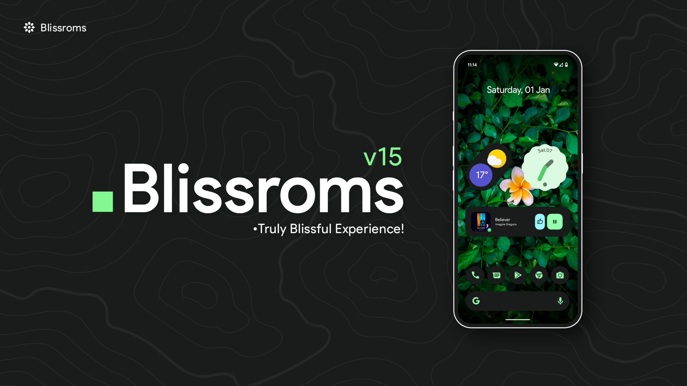

# Welcome to BlissRoms

[BlissRoms](https://blissroms.org/), an open-source operating system built upon Android Open Source Project, that offers a harmonious blend of customization, options, and security features. With a commitment to delivering pure bliss in every build, it brings with it a world of limitless possibilities.

---

## BlissRoms Important Links

- [x] [Website](https://blissroms.org)
- [x] [Blog](https://blissroms.org/blog)
- [x] [Downloads](https://blissroms.org/downloads)
- [x] [Documentation](https://docs.blissroms.org)
- [x] [Twitter](https://x.com/bliss_roms)
- [x] [Facebook](https://www.facebook.com/BlissROMs)
- [x] [Instagram](https://www.instagram.com/blissroms)
- [x] [Mastodon](https://mastodon.social/@blissroms)
- [x] [Bsky](https://bsky.app/profile/blissroms.bsky.social)
- [x] [Telegram](https://t.me/BlissROM_Updates)
- [x] [Reddit](https://www.reddit.com/r/BlissRoms)
- [x] [Source](https://github.com/BlissRoms)
- [x] [Device Source](https://github.com/BlissRoms-Devices)
- [x] [Gerrit Code Review](https://review.blissroms.org)
- [x] [Help us to Translate](https://translate.blissroms.org)
